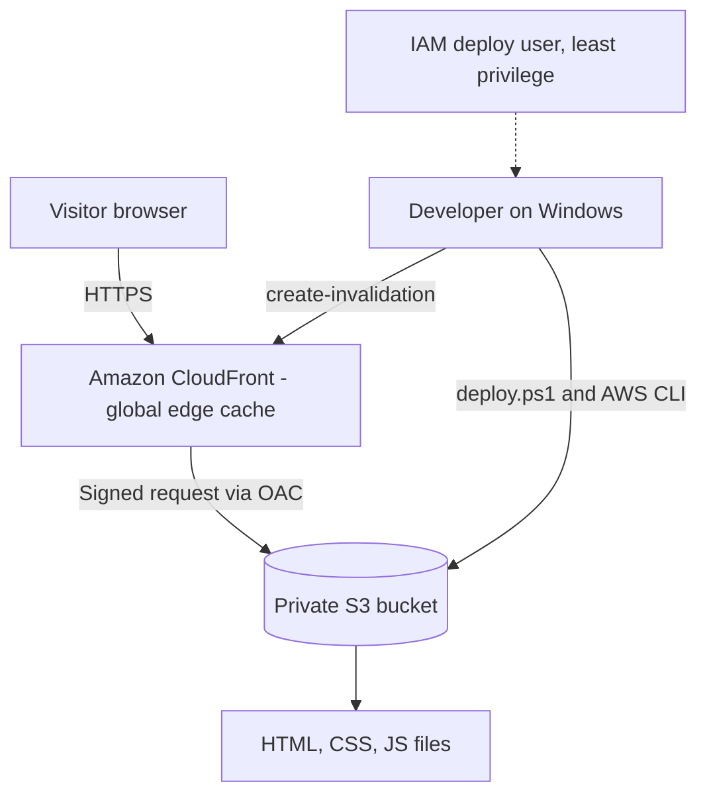

# Static Website Hosting on AWS Cloud using Amazon S3 and CloudFront

A responsive static website served globally by **Amazon CloudFront** from a **private Amazon S3 bucket**, secured with **Origin Access Control (OAC)**, deployed with **AWS CLI + PowerShell**, and versioned with **Git and GitHub**.

**Live demo:** `https://YOUR-DISTRIBUTION.cloudfront.net` (replace after deployment)

## Objectives
- Host a static site on AWS without making the S3 bucket public.
- Deliver content over HTTPS through a CDN.
- Apply least-privilege IAM for deployments.
- Automate releases and cache invalidation with scripts.

## Technologies
HTML5, CSS3, JavaScript, Amazon S3, Amazon CloudFront, Origin Access Control, AWS IAM, AWS CLI, PowerShell, Git, GitHub.

## Architecture


| Service | Role |
|---|---|
| **S3** | Stores the website files. Block Public Access is ON. |
| **CloudFront** | CDN. Terminates HTTPS, caches at edge locations, serves `index.html` as default root object, maps errors to `404.html`. |
| **OAC** | Lets CloudFront sign requests to S3. The bucket policy trusts only your distribution. |
| **IAM** | A deploy user limited to one bucket and one distribution. |
| **AWS CLI** | Uploads files and invalidates the cache. |

## Folder structure
```
static-website-hosting-aws/
├── website/
│   ├── index.html
│   ├── about.html
│   ├── 404.html
│   ├── css/style.css
│   ├── js/script.js
│   └── assets/favicon.svg
├── scripts/
│   ├── config.example.ps1      (copy to config.ps1, which is git-ignored)
│   ├── deploy.ps1
│   ├── update-website.ps1
│   └── cleanup.ps1
├── infrastructure/
│   ├── bucket-policy-template.json
│   └── deployer-iam-policy.json
├── screenshots/
├── .gitignore
├── README.md
└── LICENSE
```

## Features
Responsive layout (desktop, tablet, mobile), sticky navigation with mobile menu, animated request-path hero, About, Services, Tech stack and Contact sections, custom 404 page, keyboard focus styles, reduced-motion support, correct content types and cache headers on every upload.

## Run locally
From the project root in PowerShell:
```powershell
python -m http.server 8000 --directory website
```
Open http://localhost:8000. Stop with `Ctrl+C`. Visit http://localhost:8000/missing to see Python's own 404 (the custom 404 page works only on CloudFront).

## AWS deployment (AWS Management Console)
Pick one Region for the bucket (for example `ap-south-1` Asia Pacific (Mumbai)) and use it consistently. Console layouts change slightly over time; follow the field names.

### 1. AWS account and MFA
1. Go to https://aws.amazon.com and choose **Create an AWS Account**. A payment card is required.
2. Sign in as root, open the account menu (top right) > **Security credentials** > **Multi-factor authentication (MFA)** > **Assign MFA device**. Do not use root for daily work.

### 2. Create the least-privilege IAM deploy user
1. Console search **IAM** > **Users** > **Create user**. Name: `static-site-deployer`. Do not enable console access. **Next**.
2. **Attach policies directly** > **Create policy** > **JSON** tab. Paste `infrastructure/deployer-iam-policy.json` after replacing `YOUR-BUCKET-NAME`, `YOUR-ACCOUNT-ID` (12-digit number under the account menu) and `YOUR-DISTRIBUTION-ID` (you will get it in step 6; you can edit the policy afterwards). Name it `StaticSiteDeployPolicy` and attach it to the user.
3. Open the user > **Security credentials** > **Create access key** > use case **Command Line Interface (CLI)** > create. Copy the keys straight into the next step. Never paste them into files, chat or GitHub.

### 3. Configure AWS CLI on Windows
1. Install AWS CLI v2 from https://aws.amazon.com/cli/ (Windows MSI), then open a **new** PowerShell and run `aws --version`.
2. Run:
```powershell
aws configure --profile static-site
```
Enter the access key ID, secret access key, default Region (for example `ap-south-1`) and output format `json`. Keys are stored in `%UserProfile%\.aws\credentials`, outside the project.
3. Verify: `aws sts get-caller-identity --profile static-site`.

### 4. Create a private S3 bucket
1. Console > **S3** > **Create bucket**.
2. **Bucket name**: globally unique, lowercase, for example `edgefolio-yourname-2026`. **AWS Region**: your chosen Region.
3. **Object Ownership**: ACLs disabled (recommended).
4. **Block Public Access settings for this bucket**: keep **Block *all* public access** checked.
5. Leave **Default encryption** as SSE-S3. Do **not** enable Static website hosting. Choose **Create bucket**.

### 5. Configure the scripts and upload the files
```powershell
Copy-Item scripts\config.example.ps1 scripts\config.ps1
code scripts\config.ps1     # set BUCKET_NAME and AWS_PROFILE = 'static-site'
.\scripts\deploy.ps1 -SkipInvalidation
```
If PowerShell blocks scripts: `Set-ExecutionPolicy -Scope CurrentUser RemoteSigned`. In S3 > your bucket > **Objects** you should now see the files.

### 6. Create the CloudFront distribution
1. Console > **CloudFront** > **Create distribution**. If asked to choose a pricing plan, read each plan's price and limits first and choose deliberately.
2. **Origin domain**: choose your bucket from the list (the `...s3.<region>.amazonaws.com` entry, not a website endpoint).
3. **Origin access**: **Origin access control settings (recommended)** > **Create new OAC** > keep defaults (Signing behavior: *Sign requests*) > **Create**.
4. **Default cache behavior**: Viewer protocol policy **Redirect HTTP to HTTPS**; Allowed HTTP methods **GET, HEAD**; Cache policy **CachingOptimized**; Compress objects automatically **Yes**.
5. **Web Application Firewall**: leave disabled (it adds cost).
6. **Settings** > **Default root object**: `index.html`. Keep the default CloudFront certificate (provides HTTPS on `*.cloudfront.net`).
7. **Create distribution**. Copy the **Distribution ID** (starts with `E`) and **Distribution domain name** (`dxxxx.cloudfront.net`). Status shows *Deploying* for a few minutes.

### 7. Add the bucket policy (OAC)
1. On the distribution's **Origins** tab, select the origin > **Edit**; the console offers a **Copy policy** button. Alternatively use `infrastructure/bucket-policy-template.json` and replace the three placeholders.
2. S3 > your bucket > **Permissions** > **Bucket policy** > **Edit** > paste > **Save changes**.
3. Confirm **Block Public Access** is still ON. The policy grants access only to the CloudFront service principal for your one distribution.

### 8. Custom 404 page
CloudFront > your distribution > **Error pages** > **Create custom error response**. Create two:

| HTTP error code | Error caching minimum TTL | Customize error response | Response page path | HTTP response code |
|---|---|---|---|---|
| 403 | 10 | Yes | `/404.html` | 404 |
| 404 | 10 | Yes | `/404.html` | 404 |

A missing key on a private bucket returns 403, so both codes are mapped.

### 9. Finish configuration and test
Put the Distribution ID into `scripts\config.ps1` and into the IAM policy resource, then:
```powershell
.\scripts\deploy.ps1
```
Open `https://YOUR-DISTRIBUTION.cloudfront.net` once the distribution status is **Enabled** (Last modified shows a date).

### 10. Update the website later
Edit files in `website/`, then:
```powershell
.\scripts\update-website.ps1
```
This lists local changes, uploads, and invalidates `/*`. Hard refresh with `Ctrl+Shift+R`.

### 11. Push to GitHub
```powershell
git init
git add .
git status          # confirm scripts/config.ps1 is NOT listed
git commit -m "Initial commit: static website on S3 and CloudFront"
git branch -M main
git remote add origin https://github.com/YOUR-GITHUB-USERNAME/static-website-hosting-aws.git
git push -u origin main
```
Create the empty repository first at github.com > **New repository** (no README or license).

## Testing checklist
- [ ] `https://<distribution>.cloudfront.net` loads the home page.
- [ ] `http://` redirects to `https://`; the browser shows the padlock.
- [ ] Layout is correct at 1280px, 768px and 375px (browser DevTools device toolbar, `F12`, `Ctrl+Shift+M`) and on a real phone.
- [ ] `/about.html` loads; navigation and mobile menu work.
- [ ] `curl.exe -I https://<distribution>.cloudfront.net/css/style.css` shows `200`, `content-type: text/css` and an `x-cache` header (`Miss` first, `Hit` later).
- [ ] Direct S3 access is blocked: `curl.exe -I https://<bucket>.s3.<region>.amazonaws.com/index.html` returns `403`.
- [ ] `https://<distribution>.cloudfront.net/does-not-exist` shows the custom 404 page with status 404.
- [ ] Change a heading, run `update-website.ps1`, wait for the invalidation, and confirm the change is live.

## Troubleshooting
| Problem | Likely cause and fix |
|---|---|
| **AccessDenied / 403 on every page** | Bucket policy missing or wrong. Check bucket name, account ID and distribution ID in the policy; the origin must be the S3 REST endpoint with OAC, not a website endpoint. |
| **403 only on `/` ** | Default root object not set. CloudFront > Settings > Edit > `index.html`. |
| **Distribution not ready / old URL not working** | Status must be **Enabled** and not *Deploying*. Wait 5 to 15 minutes. |
| **Incorrect bucket policy on save** | Invalid JSON or placeholder left in. Validate and replace every `YOUR-` value. |
| **`aws` not recognised** | Install AWS CLI v2, then open a new PowerShell. |
| **Unable to locate credentials / InvalidAccessKeyId** | Run `aws configure --profile static-site` and set `AWS_PROFILE` in `config.ps1`. |
| **Upload fails with AccessDenied** | The IAM policy bucket name is wrong, or the policy is not attached to the user. |
| **Scripts blocked by PowerShell** | `Set-ExecutionPolicy -Scope CurrentUser RemoteSigned`. |
| **Old content still showing** | Run `deploy.ps1` (creates invalidation), wait a few minutes, hard refresh or use a private window. |
| **CSS served as text/plain** | Upload with `deploy.ps1`, which sets content types, instead of drag-and-drop. |

## Security considerations
- The bucket stays private (Block Public Access on); only CloudFront can read it via OAC and a distribution-scoped policy.
- HTTPS enforced by CloudFront (HTTP redirects to HTTPS).
- Credentials live only in `%UserProfile%\.aws`; scripts and repo contain none. `scripts/config.ps1` is git-ignored.
- The deploy user has write access to one bucket and invalidation on one distribution. Rotate or delete its access key when unused.
- Enable MFA on the root user; do not create root access keys.
- If a key is ever committed or shared: IAM > user > Security credentials > **Make inactive**, then delete it and create a new one. Removing it from Git history alone is not enough.

## Cost considerations
This project is not guaranteed to be free. Possible charges: S3 storage and requests; CloudFront data transfer out and requests (and invalidation paths beyond any monthly allowance); optional extras such as WAF, custom domains with Route 53, and S3 versioning. The AWS Free Tier and CloudFront plans change over time, so check https://aws.amazon.com/free and https://aws.amazon.com/cloudfront/pricing/ for current terms.
Monitor costs: console > **Billing and Cost Management** > **Budgets** > **Create budget** (a small monthly cost budget with email alerts), and review **Cost Explorer** weekly. When finished, run the cleanup below.

## Cleanup
```powershell
.\scripts\cleanup.ps1               # prints safe removal order
.\scripts\cleanup.ps1 -EmptyBucket  # empties the bucket after confirmation
```
Then delete the distribution, OAC, bucket and IAM user in the order printed.

## Screenshots
Add images to `screenshots/` and link them here:
```markdown


```

## Future enhancements
Custom domain with Route 53 and an ACM certificate, CloudFront response headers policy (HSTS, CSP), AWS WAF, CI/CD with GitHub Actions and OIDC, infrastructure as code (Terraform or AWS CDK), CloudFront access logs and CloudWatch alarms.

## License
MIT. See [LICENSE](LICENSE).
